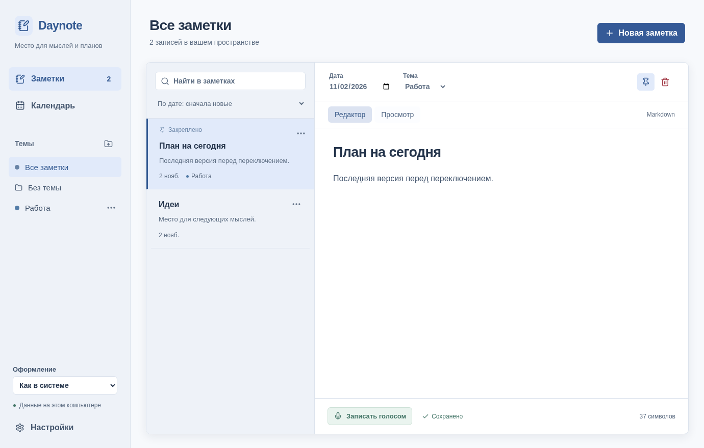
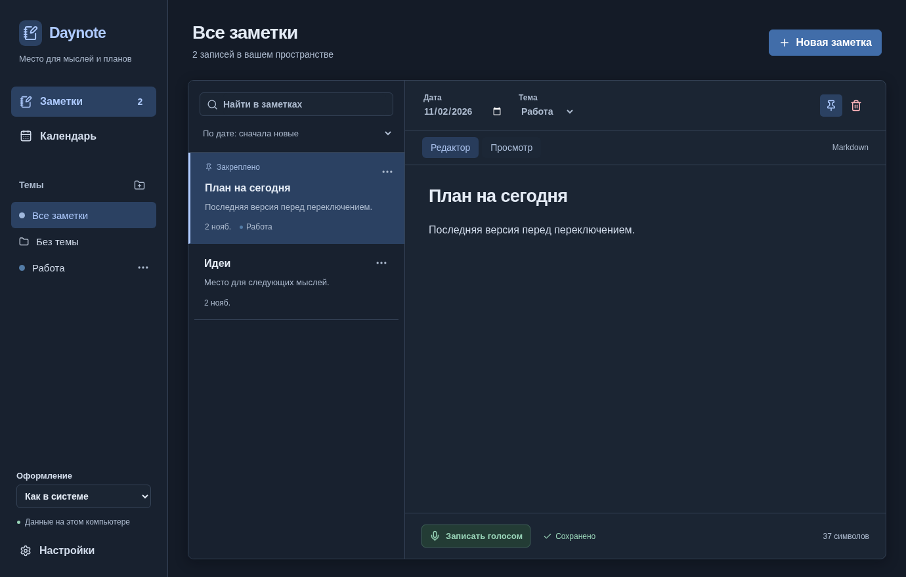
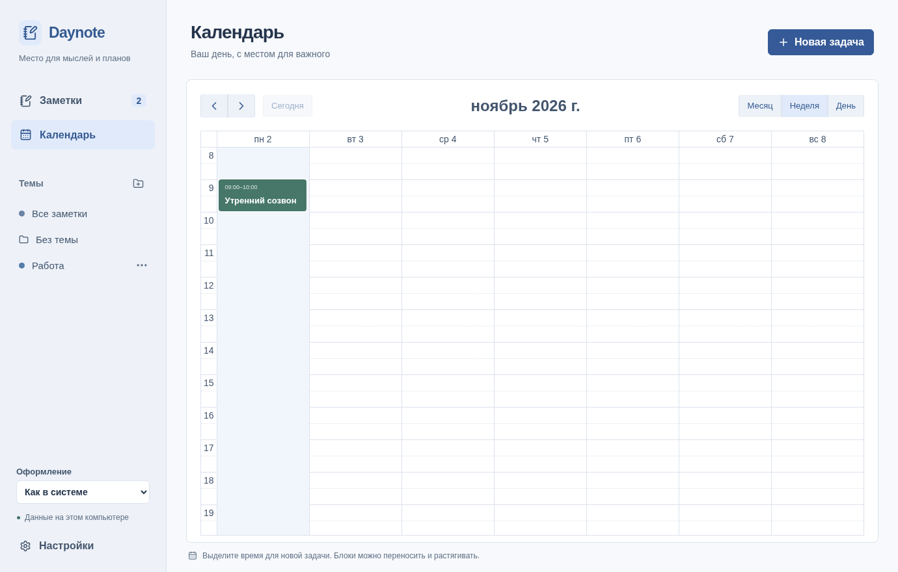

# Daynote

Заметки и календарь в одном Windows-приложении. Go + Wails v2 + React/TypeScript + Vite+.







Снимки настоящего интерфейса с тестовыми данными браузерной проверки. При первом запуске приложение пустое.

- Темы с цветами и ручным порядком, поиск по заметкам, действия по правой кнопке или кнопке «…».
- Светлая, тёмная и системная тема с сохранением выбора; более крупные шрифты и элементы управления.
- Markdown: редактор и просмотр, заголовки, списки, таблицы, чекбоксы и блоки кода. Raw HTML не исполняется, изображения не загружаются автоматически.
- Дата у каждой заметки, сортировка в обе стороны или собственный порядок; закрепление сверху.
- Календарь месяца, недели и дня. Задачи с началом и концом, переносом и изменением длительности, отметкой завершения.
- Несколько заметок у задачи: прикрепить существующую или создать новую прямо в карточке.
- Голос с микрофона через Gemini Transcribe Live. Текст можно проверить и исправить перед добавлением.
- Локальное хранение и автоматические резервные копии в выбранной папке, в том числе OneDrive.

## Windows

Скачайте `Daynote-windows-x64` из **Actions → CI → успешный запуск → Artifacts**, распакуйте архив и запустите `Daynote.exe`. Это unsigned-приложение: Windows может показать SmartScreen. Контрольная сумма EXE находится рядом в `SHA256SUMS.txt`. Требуется Windows x64 и [Microsoft WebView2 Runtime](https://developer.microsoft.com/en-us/microsoft-edge/webview2/).

Оформление переключается внизу боковой панели: «Как в системе», «Светлое», «Тёмное». У заметок и тем откройте меню правой кнопкой или кнопкой «…»; удалять объект можно прямо из списка. В редакторе заметки вкладка «Просмотр» отображает Markdown.

В приложении нет аккаунта и обязательного подключения к интернету. Для обычных заметок и календаря сеть не нужна. Первая версия не включает повторяющиеся события, системные напоминания или синхронизацию между ПК.

### Как пользоваться

Создайте тему кнопкой рядом с «Темы» и добавьте заметку. Её дата меняется независимо от времени создания. Выберите «Мой порядок», чтобы переставлять заметки стрелками; порядок сохраняется при переключении сортировки. Закреплённые заметки всегда выше остальных. Стрелки тем появляются при наведении/фокусе. При активном поиске перестановка заметок отключена.

В календаре нажмите «Новая задача» или выделите интервал. В карточке отметьте нужные заметки либо используйте «Новая заметка → Создать и прикрепить». Заметки сохраняются самостоятельно: удаление задачи их не удаляет. Перед закрытием/переходом приложение сохраняет текущую заметку; при ошибке остаётся редактируемый черновик.

### Голос

Откройте **Настройки → Голосовые заметки**, сохраните собственный API-ключ Google Gemini. Он должен иметь доступ к `gemini-3.5-transcribe-live`; доступность модели и региона определяется Google. Нажмите «Записать голосом» в заметке, говорите, остановите запись, проверьте текст и нажмите «Добавить в заметку». Уже написанный текст сохраняется. После остановки приложение до трёх секунд получает оставшиеся ответы; поскольку Gemini не подтверждает обработку всего потока отдельным сигналом, появляется предупреждение проверить последнюю фразу. Доступный текст остаётся редактируемым.

Используется микрофон Windows по умолчанию. При отсутствии звука проверьте Windows Settings → Privacy & security → Microphone и выбранное устройство. Одна сессия модели ограничена десятью минутами; для длинного текста остановите и начните новую запись. Сеть, ключ, квоты и API могут приводить к ошибкам; приложение их показывает. Потеря звука из-за перегрузки очереди не скрывается. Автоматического переподключения/повторной отправки нет. См. [документацию Google](https://ai.google.dev/gemini-api/docs/live-api/live-transcribe).

Звук передаётся Google только после запуска записи и не сохраняется на диске. Обычные заметки автоматически в Google не отправляются. Ключ хранится в Windows Credential Manager под именем `Daynote/stt-gemini`, отдельно от заметок, и не включается в резервные копии. Реальные ключи не нужны для тестов.

### Данные и OneDrive

Рабочая база: `%LOCALAPPDATA%\Daynote\daynote.db`. Настройки: `%LOCALAPPDATA%\Daynote\settings.json`. Не переносите рабочую базу в OneDrive. Эксклюзивная блокировка файла owner.lock защищает каталог от двух владельцев, в том числе в разных сеансах Windows.

В настройках выберите существующую папку **внутри вашего OneDrive**. Daynote проверяет возможность записи и после изменений создаёт отдельные завершённые JSON-копии. Файлы версионированы, существующие копии не перезаписываются. Ошибка OneDrive не мешает локальному сохранению. Загрузка в облако — ответственность клиента OneDrive; Daynote подтверждает только запись файла в папку. Старые копии нужно удалять самостоятельно. Максимальный размер одной JSON-копии — 64 МБ; при превышении лимита приложение сообщит об ошибке копирования, локальные записи сохранятся.

Резервные копии содержат весь текст заметок и задач, не шифруются самим Daynote и защищаются правами вашей папки/аккаунта OneDrive. Кнопка «Открыть резервную копию» проверяет JSON и запрашивает подтверждение полной замены. Текущие данные перед заменой сохраняются в `%LOCALAPPDATA%\Daynote\recovery`. Ключ Gemini и путь папки резервных копий при восстановлении не меняются. Между компьютерами можно вручную переносить копии; автоматической синхронизации нет.

Дата заметки — календарная дата без времени. Время задач сохраняется как момент времени и отображается в локальном часовом поясе Windows. При смене часового пояса местное время события изменяется.

## Разработка

Требуются Go из `go.mod` и [Vite+](https://viteplus.dev/guide/installation). Vite+ управляет Node.js 24+ и pnpm из `frontend/package.json`. Для обычного `make dev` нужна Windows. В WSL можно запускать тесты и собирать Windows EXE; это не запускает Windows GUI.

```sh
make install
make check
# результат: build/bin/Daynote.exe
```

На Windows для разработки:

```sh
make dev
```

Без Make используйте команды из `Makefile` через Git Bash либо Wails CLI: `go run github.com/wailsapp/wails/v2/cmd/wails@v2.17.0 dev`. `make bindings` регенерирует Wails bridge штатным генератором; generated-файлы не редактируются вручную.

Тесты Go проверяют реальную временную SQLite-базу, восстановление, ошибки экспорта и голосовую сессию с fake transport/capture. React-тесты проверяют сохранение при смене заметки, сохранение черновика при ошибке, прикрепление заметки к задаче и явное применение голосового текста. Windows CI отдельно запускает платформенные тесты и собирает EXE. Ручная приёмка описана в [docs/windows-acceptance.md](docs/windows-acceptance.md); кросс-сборка её не заменяет.

Дизайн: [описание первой версии](https://github.com/97Dmitry/daynote/blob/main/docs/superpowers/specs/2026-11-02-daynote-design.md). Узкие части WASAPI/Gemini/Credential Manager перенесены из собственного проекта [Solveo](https://github.com/97Dmitry/solveo); его данные и настройки не используются.
